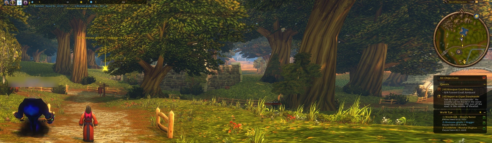
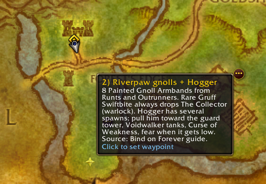
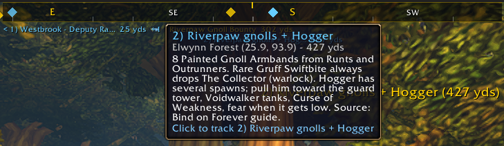

# WoW Eye

**An AI companion for World of Warcraft: Forever.** WoW Eye pairs an in-game addon with an [MCP](https://modelcontextprotocol.io) server, so an AI agent like Claude can read your character's state and guide you through the game. It shows directions on your map, in a compass bar, as an in-world beacon and in an in-game panel.

You talk to the agent the way you normally would, in Claude Code, Claude Desktop or any other MCP client. You might ask "what's next in my leveling guide?", "where's the closest flight master I've found?" or "what should I train at 12?" The agent answers from your real game data and can put the route on your screen.



## What it does

- **Reads your game.** Character, location, quests with the game's own objective locations, gear and bags with stats, spells, talents, professions, reputation and every quest you've completed. It also records the NPCs, vendors, trainers and flight masters you visit, with their real positions.
- **Puts directions in the game.**
  - **Map markers** with notes, which become your waypoint.
  - A **beacon** in the 3D world over whatever you're tracking.
  - A **WoW Eye list** under the quest tracker.
  - A **compass bar** across the top of the screen with every target on it.
  - **Routes** that advance on their own as you arrive or finish quests.
- **Shows the agent's notes** in an in-game panel you open with `/eye`.
- **Tracks your sessions:** XP per hour, deaths, time per zone and combat share, so the agent can spot what's slowing you down.

<!-- More feature images: uncomment as each file is added.


-->

## How it works

Addons can't write files or use the network, so the addon and the agent swap data through two files. The swap happens whenever the game reloads its interface:

```
Game (WowEye addon)                                      Agent (MCP server or CLI)
  snapshot + events  ->  SavedVariables/WowEye.lua  ---->  wow_snapshot, wow_events, ...
  panel, markers     <-  addon/WowEye/Inbox.lua     <----  wow_send_to_panel, wow_set_map_markers, ...

                 both directions update on /eye sync (a UI reload)
```

**The data isn't live.** The agent sees the game as of your last `/eye sync`, UI reload or logout, and anything it sends shows up after the next one. Routes, the compass and the beacon keep working between syncs, because they run in the addon.

## Requirements

- World of Warcraft: Forever.
- Windows. The `wow-eye install` command uses a Windows directory junction. On macOS, link or copy the addon by hand (see [Install the addon](#2-install-the-addon)).
- [uv](https://docs.astral.sh/uv/), which also installs Python 3.12 or newer if you don't have it.
- An MCP client, such as [Claude Code](https://claude.com/claude-code) or Claude Desktop, if you want an agent. The CLI works without one.

## Setup

### 1. Get the code

```powershell
git clone https://github.com/TravinDSO/woweye.git
cd woweye
uv sync
```

### 2. Install the addon

```powershell
uv run wow-eye game-dir      # shows the game folder WoW Eye found
uv run wow-eye install
```

WoW Eye looks for the game in the usual places: Program Files, and a `World of Warcraft` or `Games\World of Warcraft` folder at the root of drives C to H. If yours is somewhere else, or `game-dir` shows the wrong folder, save the right one. It's the `_forever_` folder, the one containing `Interface` and `WTF`:

```powershell
uv run wow-eye game-dir "E:\Blizzard\World of Warcraft\_forever_"
```

That writes `wow-eye.local.toml` in the repo folder. Git ignores it, so your path stays on your PC. A `WOW_EYE_GAME_DIR` environment variable, if set, takes priority over both the file and detection.

`install` links `addon/WowEye` into the game's `Interface/AddOns` folder, so you can update by pulling the repo and reloading in game. It also creates `addon/WowEye/Inbox.lua`, which the addon needs at startup. `uv run wow-eye uninstall` removes the link and leaves your saved data alone.

**macOS or manual install:** run `uv run wow-eye clear` once to create `Inbox.lua`. Then link the folder yourself, for example `ln -s "$(pwd)/addon/WowEye" "<game folder>/Interface/AddOns/WowEye"`.

### 3. First sync

1. **Restart the game completely.** WoW only finds new addons at startup.
2. At character select, open **AddOns** and make sure **WoW Eye** is enabled.
3. Log in and type `/eye sync`. The UI reloads and writes your first snapshot. You'll sync often, so bind a key to it now: open the game's Keybindings menu, find **WoW Eye** under **AddOns**, and set **WoW Eye Sync (reloadUI)**.
4. Check that the agent side sees it:

   ```powershell
   uv run wow-eye status
   ```

   You want `addon_installed: true`, your character listed, and a small `snapshot_age_seconds`.

### 4. Connect the MCP server

The MCP server is `wow-eye-mcp`. It talks to your client over stdio and finds the game folder the same way the CLI does, so once `uv run wow-eye game-dir` shows the right folder, the server needs no extra settings.

**Claude Code, in this folder:** the repo's `.mcp.json` already defines the server. Open Claude Code in the `woweye` folder and approve the `wow-eye` server when asked.

**Claude Code, from any folder:** register it once for your user:

```powershell
claude mcp add wow-eye --scope user -- uv --directory "C:\path\to\woweye" run --quiet wow-eye-mcp
```

**Claude Desktop:** in Settings, open Developer and choose Edit Config. Add this to `claude_desktop_config.json`, then restart Claude Desktop:

```json
{
  "mcpServers": {
    "wow-eye": {
      "command": "uv",
      "args": ["--directory", "C:\path\to\woweye", "run", "--quiet", "wow-eye-mcp"]
    }
  }
}
```

**Other MCP clients:** run `uv --directory <repo> run --quiet wow-eye-mcp` as a stdio server.

To check the connection, ask your agent "check my WoW Eye status". It should call `wow_status` and report your character and how old the data is.

### MCP tools

| Tool | What it does |
| --- | --- |
| `wow_status` | Whether the addon is installed, which characters have data, and how old it is |
| `wow_snapshot` | The latest snapshot, or one section: `identity`, `location`, `money`, `quests`, `equipment`, `bags`, `spells`, `talents`, `professions`, `reputation` |
| `wow_events` | Recent events: level-ups, deaths, quests accepted and turned in, zone changes |
| `wow_completed_quests` | Every quest the character has finished, or a check of specific quest IDs |
| `wow_npcs` | NPCs you've talked to, with their real positions, filterable by name, role and map |
| `wow_vendors` | Stock and prices at vendors you've opened |
| `wow_trainers` | What trainers you've opened can teach, with cost and level |
| `wow_flight_paths` | Flight nodes seen at flight masters |
| `wow_session` | XP per hour, money, deaths, quests, combat share and time per zone |
| `wow_set_map_markers` | Replace your map markers; the first becomes your waypoint |
| `wow_set_route` | Set an ordered route that advances on its own |
| `wow_route_status` | The current route and your progress at the last sync |
| `wow_send_to_panel` | Queue a message for the in-game panel |
| `wow_clear_panel` | Remove all panel messages |

The character-data tools take an optional `character` (`Name-Realm`) and default to the last character you played.

## In the game

### Commands

| Command | What it does |
| --- | --- |
| `/eye` | Open or close the panel |
| `/eye sync` | Capture a snapshot and reload the UI, which swaps data with the agent |
| `/eye snap` | Capture a snapshot without reloading (it isn't saved to disk until the next sync) |
| `/eye way` | Set the waypoint to the first map marker again |
| `/eye beacon` | Turn the in-world beacon on or off |
| `/eye next`, `/eye prev` | Move to the next or previous route step |
| `/eye route` | Show the current route step in chat |
| `/eye list` | Show or hide the WoW Eye list under the quest tracker |
| `/eye compass` | Show or hide the compass bar |
| `/eye party` | Show or hide party members on the compass |

### Keybindings

Open the game's Keybindings menu and look under **AddOns** for **WoW Eye**:

| Binding | Same as |
| --- | --- |
| **WoW Eye Sync (reloadUI)** | `/eye sync` |
| **WoW Eye Beacon (toggle)** | `/eye beacon` |
| **WoW Eye Party Markers (toggle)** | `/eye party` |
| **Open or close panel** | `/eye` |
| **Route: next step** | `/eye next` |
| **Route: previous step** | `/eye prev` |

**WoW Eye Sync (reloadUI)** is the one worth binding first. Press it whenever you want the agent to see where you are now, or to pick up markers and messages it just sent.

### The panel

The panel is where the agent leaves notes for you: a quest plan, what to buy, or a reminder for later. Open it with `/eye` or the **Open or close panel** keybinding.

- **Messages:** the agent sends them with `wow_send_to_panel` (or `wow-eye send` from the CLI). They arrive on your next sync, newest first. When there are new ones, chat says "new messages from your agent" after you log in or reload.
- **Route:** if the agent has set a route, the top of the panel lists every step and marks how far you've got.
- **Controls:** drag the panel to move it, and press Escape to close it. The **Sync (reload UI)** button at the bottom does the same as `/eye sync`.

Until the agent sends something, the panel says "No messages yet". Ask your agent to "send the plan to my WoW Eye panel" to see one.

### Map markers and the beacon

Markers from the agent appear as icons on the world map and are listed in chat. New markers make the first one your waypoint, and clicking any pin makes that one the waypoint. A marker only shows on the exact map it was set for, not on the continent view.



The **beacon** is a pulsing ring and beam in the 3D world, with the target's name and distance. It follows whatever the game is guiding you to: a WoW Eye marker or the quest you've selected. There's only one, because the game gives addons a single frame that follows the tracked target. It hides in combat.

### WoW Eye list

Route steps and markers are listed in a **WoW Eye** section below the quest tracker, so you can read them without opening the map. Each entry shows its zone and coordinates, and the current waypoint is highlighted in blue.
- Click an entry to make it your waypoint, and hover for its note.
- Click the header to collapse the section. The star button in the header turns the beacon on or off.
- The button on the right of each entry shows or hides that entry on the compass.
- The section's background follows the tracker's Opacity setting in Edit Mode.

### Compass

A **compass bar** at the top of the screen turns with your character. Headings and tick marks scroll across it, covering 90 degrees either side of the way you face.
- **Targets:** each one is a pin on the bar, with its name and distance below it. WoW Eye entries are blue, quests are gold, and anything within 15 yards is green.
- **Behind you:** a target behind you sits at the end of the bar on the side to turn to, marked `<` or `>`.
- **Shared pins:** targets at nearly the same spot share a pin, labeled like `Surena Caledon  686 yds  +2`.
- **Party members:** they get their own thin lane on top of the bar, so they never crowd the quest and WoW Eye pins. Each member is a pin in their class color with a red border, and the party leader's has a gold ring around the red. Their name and distance sit beside the pin. Members in an instance, offline or on another continent don't show, and the lane hides when there's nobody to show. Turn them off or on with `/eye party` or the **WoW Eye Party Markers (toggle)** keybinding.
- **Mouse:** hover a pin or label to see everything there, and click a target to track it.
- **What's on it:** every WoW Eye entry and every quest in your tracker, by default. To hide one, or to add a quest you aren't tracking, right-click it in the quest tracker or the map's quest log and use **Show on WoW Eye compass**.
- **Moving it:** open Edit Mode and drag the bar. Right-click it there to put it back at the top.



The compass goes by the way your character faces, not the camera. The game doesn't give addons your facing inside dungeons and other instances, so the bar hides there. It stays up in combat in the open world, so you can keep track of your party and targets mid-fight.

### Routes

A route is an ordered plan that keeps advancing without more syncs. The waypoint and beacon follow the current step, and the panel lists the whole route. Each step moves on when you arrive or when a quest is accepted, completed or turned in. Your next and previous keys always work.

## The CLI

Everything the agent can do is also a command, which is handy for testing or for scripting your own tools.

```powershell
uv run wow-eye status
uv run wow-eye snapshot --section quests
uv run wow-eye completed 62 83
uv run wow-eye send "Next step" "Turn in your quest in Goldshire."
uv run wow-eye mark 1429 42.1 65.9 "Marshal Dughan" --zone "Elwynn Forest" --note "Quest hub"
uv run wow-eye unmark
uv run wow-eye route steps.json --goal "Reach level 12"
```

Run `uv run wow-eye --help` for the full list. Map coordinates are percentages (0-100), as shown in game. The map ID is the game's `uiMapID`, which the snapshot's `location` section gives you.

A route file is a list of steps:

```json
[
  {"map_id": 1429, "x": 42.1, "y": 65.9, "label": "Pick up the quest", "complete_on": "quest_accepted", "quest_id": 123},
  {"map_id": 1429, "x": 50, "y": 40, "label": "Kill wolves", "complete_on": "quest_complete", "quest_id": 123},
  {"map_id": 1429, "x": 42.1, "y": 65.9, "label": "Turn in", "complete_on": "quest_turned_in", "quest_id": 123},
  {"map_id": 1429, "x": 83.2, "y": 66.1, "label": "Repair", "radius": 15, "note": "Rallic Finn"}
]
```

`complete_on` is `arrive` (the default: within `radius` yards, 12 if not given), `quest_accepted`, `quest_complete`, `quest_turned_in` or `manual`.

## Safety and fair play

WoW Eye is built to stay within what Blizzard allows addons to do:

- **It only reads.** There's no input automation, memory reading, injected code or modified game files. The agent can't act in the game. It can only show you information.
- **No hidden data.** Values the game marks secret are dropped and counted, never reconstructed, and no snapshot is taken during combat.
- **Navigation only.** The beacon and routes hide in combat. The compass stays up in open-world combat but only shows directions and distances, like the minimap, and it hides in instances. All of it is meant for questing and travel, not for encounter mechanics.
- **Agent text is shown as plain text.** Messages and labels from the agent can't run code or use the game's text formatting codes.

As with any addon, you're responsible for using it within the game's terms.

## Limits

- **Not live:** data moves only on a UI reload or logout.
- **Saved files:** the game rewrites its saved data on reload and logout. WoW Eye only reads that file and never edits it.
- **Approximate NPC positions:** recorded NPC positions are where you stood when you talked to them, which is close but not exact.
- **New quest IDs:** Forever adds new quests, so quest IDs from Classic sources may not match.

## Development

```powershell
uv sync
uv run pytest
```

The tests run the real addon files in Lua 5.1 (through `lupa`) against a fake WoW API, plus the Python bridge, CLI and MCP server. They don't prove the addon works in the real client, so check UI changes in game with `/reload`. Turn on Lua errors with `/console scriptErrors 1`.

```
addon/WowEye/   the addon: Core, Snapshot, Panel, Pins (markers, beacon, list, compass), Route, Tracking
src/wow_eye/    savedvars (Lua data parser), bridge, cli, mcp_server
tests/          addon tests against a fake WoW API, plus bridge and server tests
docs/images/    screenshots for this README
```

`CLAUDE.md` holds the project's working rules for AI coding agents, and it doubles as a guide to the addon's design.

## License

[MIT](LICENSE). World of Warcraft is a trademark of Blizzard Entertainment, and WoW Eye isn't affiliated with or endorsed by Blizzard.
